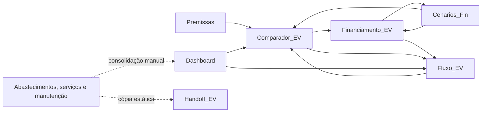

# Modelo financeiro

## 1. Objetivo e escopo

Este documento registra o comportamento financeiro observado na planilha de referência e define, separadamente, o modelo conceitual que deverá orientar o aplicativo.

Referência canônica: `reference/TCO_Tiida_EV_Financiamento_Integrado.xlsx`.

A referência descreve um Nissan Tiida e um candidato elétrico. Seus valores servem para reconciliação, não como regras, limites ou valores padrão do produto. O domínio futuro deve comparar veículos ICE, HEV, PHEV e BEV.

### Classificação das regras

- **Formulada:** existe como fórmula rastreável na planilha.
- **Estática:** existe como valor digitado, importado ou copiado, sem vínculo ativo com sua origem.
- **Inferida:** foi deduzida de textos, resultados ou requisitos do produto, mas não está integralmente implementada por fórmula.

Toda referência de célula neste documento usa o formato `Aba!Intervalo`. Valores monetários estão em reais, salvo indicação contrária.

## 2. Glossário financeiro

### TCO de caixa

Soma das saídas operacionais atribuídas ao uso e à propriedade do veículo no período. Na referência, inclui energia ou combustível, manutenção, seguro, IPVA e licenciamento. Não inclui aquisição, entrada nem pagamento de principal do financiamento.

### TCO econômico

TCO de caixa acrescido dos custos econômicos reconhecidos no período, como depreciação e encargos financeiros. O horizonte, a periodicidade e os componentes incluídos devem sempre ser explícitos.

### Fluxo de caixa do financiamento

Movimentação efetiva de caixa associada à dívida: entrada, prestações, juros, tarifas, correção, seguros financeiros e amortizações extraordinárias. Deve ser apresentado separadamente do TCO operacional e do TCO econômico.

### Principal amortizado

O pagamento de principal reduz caixa e passivo simultaneamente. Isoladamente, não é custo econômico e não reduz o patrimônio líquido. Juros, tarifas e outros encargos podem ser custos econômicos e reduzir o patrimônio líquido quando reconhecidos como despesa.

### Parcela líquida da troca

Na planilha atual:

```text
pagamento do financiamento
+ TCO de caixa mensal do veículo candidato
- TCO de caixa mensal do Tiida
```

Resultado positivo representa saída adicional de caixa. Resultado negativo representa economia mensal de caixa.

## 3. Comportamento atual da planilha

Esta seção descreve o que a referência faz hoje. Não transforma limitações, valores estáticos ou nomes centrados em EV em requisitos do aplicativo.

### 3.1 Abas e responsabilidades

| Aba | Responsabilidade atual |
| --- | --- |
| `Premissas` | Guarda premissas, fontes e alguns cálculos do Tiida. |
| `Abastecimentos_12m` | Contém 93 registros de abastecimento usados como histórico recente. |
| `Servicos_12m` | Contém 64 itens de serviço classificados para o TCO. |
| `Historico_Manutencao` | Consolida registros de manutenção desde 2021 e apresenta cenários estáticos. |
| `Historico_Mensal` | Consolida combustível, serviços, seguro e tributos por mês. |
| `Dashboard` | Apresenta o baseline do Tiida e sensibilidades de manutenção. |
| `Comparador_EV` | Reúne entradas do candidato atual, financiamento e resultados da troca. |
| `Financiamento_EV` | Calcula o cronograma mensal do cenário ativo por até 120 meses. |
| `Cenarios_Fin` | Compara três estratégias atuais de amortização. |
| `Fluxo_EV` | Projeta financiamento, operação e delta mensal de caixa. |
| `Handoff_EV` | Mantém um resumo textual estático para reutilização externa. |

Os nomes com sufixo `_EV` descrevem a implementação atual. Não definem o limite do domínio futuro.

### 3.2 Dependências entre abas



As setas de retorno representam células de resumo, não ciclos financeiros intencionais. Por exemplo, `Cenarios_Fin` usa entradas vinculadas de `Financiamento_EV`, enquanto este consulta o juros-base de `Cenarios_Fin` apenas para calcular a economia de juros.

As abas históricas não alimentam o `Dashboard` por fórmulas entre abas. Os valores foram consolidados e copiados, o que permite divergência após atualizações.

### 3.3 Entradas manuais atuais

#### Premissas do Tiida

As células manuais estão em `Premissas!B4:B6`, `B8`, `B10:B12` e `B14:B21`. `B7`, `B9` e `B13` são calculadas. As entradas abrangem odômetros, seguro, FIPE, alíquota de IPVA, licenciamento, preços e consumos de combustível, amortização das corretivas, depreciação e data-base.

#### Veículo candidato e financiamento

| Grupo | Células atuais | Conteúdo |
| --- | --- | --- |
| Compra | `Comparador_EV!B5:B6`, `B8:B10`, `B12` | Identificação, preço, troca, entrada, custos financiados e valor financiado opcional. |
| Contrato | `Comparador_EV!F5:F11` | Taxa mensal, prazo, primeira parcela, correção, aporte padrão, início e reinvestimento. |
| Operação | `Comparador_EV!J5:J7`, `J9:J10`, `J12:J13` | Consumo, tarifa, perdas, seguro, IPVA, manutenção e depreciação. |
| Aportes manuais | `Financiamento_EV!I17:I136` | Valor extraordinário que substitui o aporte padrão naquele mês. |

`Comparador_EV!B7` e `J11` são vínculos com `Premissas`; `B11`, `B13`, `J8`, `J14:J17` são cálculos.

#### Histórico

- `Abastecimentos_12m!A4:I96`: lançamentos importados do Drivvo.
- `Servicos_12m!A4:H67`: serviços, categorias e valores.
- `Historico_Manutencao!A4:H27`: registros de manutenção, período e fonte.
- `Historico_Mensal!B5:F16`: consolidação mensal estática; somente a coluna `G` e os totais da linha 18 são fórmulas.

### 3.4 TCO atual do Tiida

O histórico de 12 meses usado no `Dashboard` soma combustível real, serviços, seguro, IPVA provisionado e licenciamento. O baseline prospectivo troca combustível e manutenção históricos por valores projetados, preservando seguro e tributos atuais.

```text
TCO de caixa central anual
= combustível projetado
+ manutenção central
+ seguro
+ IPVA
+ licenciamento
```

A depreciação anual do Tiida é adicionada somente no TCO econômico. O principal amortizado de eventual financiamento não participa dessas fórmulas.

#### Cenários atuais de manutenção

- **Otimista:** preventiva e desgaste dos últimos 12 meses mais um terço das corretivas.
- **Central:** custo histórico longo por quilômetro multiplicado pela rodagem anual.
- **Central+:** custo histórico longo acrescido da proxy de peças da OS 11032, convertido para a rodagem anual.
- **Stress:** valor anualizado da posse recente. A planilha não contém a fórmula completa que produz esse valor.

### 3.5 Operação do candidato atual

O candidato atual é tratado como BEV. O custo anual de energia em `Comparador_EV!J8` é:

```text
km anuais × kWh por 100 km ÷ 100 × tarifa por kWh × (1 + perdas)
```

O TCO de caixa anual do candidato, em `J15`, soma energia, seguro, IPVA, licenciamento e manutenção. `J16` converte o total para mês. A depreciação anual em `J14` é `preço × taxa anual`; `J17` soma a depreciação ao TCO de caixa mensal.

### 3.6 Financiamento atual

O valor financiado em `Comparador_EV!B11` é limitado a zero:

```text
preço - valor líquido da troca - entrada adicional + custos financiados
```

`B13` usa esse cálculo quando disponível e recorre ao valor manual de `B12` quando o preço não foi preenchido.

A referência recebe uma taxa mensal em `Comparador_EV!F5`, transfere esse valor para `Financiamento_EV!C6` e o aplica diretamente como taxa do período. Ela não oferece entrada anual nem converte periodicidades.

As fórmulas do cronograma não realizam arredondamento intencional entre períodos. Os valores internos preservam a precisão do Excel, enquanto o formato das células exibe valores monetários com duas casas. O uso de `half-up` definido para o aplicativo na seção 4.6 é uma convenção nova do produto, não um comportamento comprovado da planilha.

Em `Financiamento_EV`, cada mês segue esta ordem:

1. Carrega o saldo final anterior.
2. Aplica correção monetária mensal ao saldo inicial.
3. Calcula juros sobre o saldo corrigido.
4. Recalcula a prestação para o saldo e prazo remanescentes.
5. Separa juros e principal da prestação.
6. Seleciona o aporte manual do mês ou o aporte recorrente padrão.
7. Calcula eventual reinvestimento da redução da prestação.
8. Limita aportes ao principal ainda disponível.
9. Calcula pagamento total e saldo final, sem permitir saldo negativo.

#### Estratégias existentes na referência

- **Baseline:** não aplica amortização extraordinária.
- **Normal:** aplica aporte padrão ou manual e recalcula a prestação para o prazo restante. Aproxima `reducePayment`.
- **Potencializada:** aplica o aporte e reinveste a redução da prestação para manter maior esforço de caixa. Aproxima `reduceTerm`, mas não representa um contrato específico de antecipação de parcelas finais.

A referência não implementa `prepayTailInstallments` como operação contratual a valor presente.

### 3.7 Resultados atuais

`Fluxo_EV!A11:P130` projeta 120 meses. Em cada período:

- O pagamento financeiro vem de `Financiamento_EV`.
- Energia, manutenção, seguro e tributos são mensalizados a partir do candidato.
- O desembolso total do candidato soma financiamento e operação.
- O baseline do Tiida usa o TCO de caixa mensal central.
- A parcela líquida é a diferença entre desembolso do candidato e baseline do Tiida.

Os resumos mostram o primeiro mês, a média enquanto há financiamento, o fluxo após a quitação, o acumulado até a quitação, o prazo efetivo e a data estimada de quitação.

## 4. Modelo financeiro generalizável para o aplicativo

Esta seção define o comportamento desejado do domínio. Ela não pressupõe abas, células ou nomes atuais da planilha.

### 4.1 Estrutura comum de um veículo

Cada cenário deve declarar:

- Identificação e motorização: `ICE`, `HEV`, `PHEV` ou `BEV`.
- Preço de aquisição e valor residual ou regra de depreciação.
- Horizonte e quilometragem anual.
- Seguro, tributos, licenciamento e manutenção.
- Fontes de energia e respectivas eficiências, preços e perdas.
- Financiamento, quando aplicável.
- Moeda, periodicidade, data-base e regras de arredondamento.

Para o MVP, o horizonte do TCO é anual normalizado. Os resultados serão apresentados em valores anuais, mensais e por quilômetro: o valor mensal deriva do anual dividido por 12, e o valor por quilômetro deriva do anual dividido pela quilometragem anual. Análises por horizonte de posse permanecem pós-MVP.

A depreciação do MVP segue a regra anual simples já documentada:

```text
depreciação anual = valor do veículo × taxa anual de depreciação
```

Curvas de depreciação e valor residual por horizonte permanecem pós-MVP. Essa escolha define o custo econômico anual do MVP, mas não resolve a composição patrimonial da compra, da revenda ou do valor residual.

### 4.2 Energia por motorização

- **ICE:** consumo de combustível líquido em km/L ou L/100 km.
- **HEV:** mesma estrutura de combustível líquido, com eficiência própria do híbrido.
- **PHEV:** percentuais da quilometragem anual em modo elétrico e em combustão, totalizando 100%. Divisões por dias, viagens ou energia medida permanecem pós-MVP.
- **BEV:** consumo em kWh/100 km, tarifa efetiva e perdas de recarga.

O modelo deve aceitar múltiplas fontes de energia sem duplicar a lógica de TCO. Cada fonte produz um custo anual; o TCO soma os custos das fontes ativas.

### 4.3 Separação dos resultados

O domínio deve produzir três visões independentes:

1. **TCO de caixa:** custos operacionais pagos no período.
2. **TCO econômico:** TCO de caixa mais depreciação e encargos econômicos definidos.
3. **Fluxo do financiamento:** entrada, prestações, principal, juros, correção, tarifas e aportes por período.

Aquisição, venda do veículo atual, entrada e principal devem aparecer no fluxo de caixa, sem serem classificados automaticamente como custo econômico.

### 4.4 Estratégias de amortização

As estratégias são mutuamente distinguíveis:

- `none`: segue o cronograma sem amortização extraordinária.
- `reducePayment`: amortiza principal, recalcula uma prestação menor e mantém o prazo contratual.
- `reduceTerm`: amortiza principal, mantém a prestação de referência e reduz o prazo.
- `prepayTailInstallments`: quita parcelas finais específicas pelo valor presente, somente quando a financeira oferecer essa operação.

`prepayTailInstallments` exige parâmetros contratuais próprios: parcelas elegíveis, data de liquidação, taxa de desconto, encargos preservados ou dispensados e arredondamento da financeira. Não deve ser calculado como mero sinônimo de `reduceTerm` e permanece pós-MVP, indisponível até essas regras serem suficientes.

Como requisito funcional futuro do produto, valores destinados a `prepayTailInstallments` podem acumular em uma reserva separada. Uma parcela final elegível somente é liquidada quando a reserva cobre integralmente seu valor de liquidação na data. O saldo não utilizado permanece disponível para períodos seguintes, e somente o valor efetivamente usado na liquidação reduz a dívida. Enquanto não utilizada, a reserva não é amortização de principal nem custo econômico. O tratamento de eventual reserva remanescente na quitação permanece uma decisão futura explícita.

A regra de reserva é um requisito aprovado do produto. Ela não representa comportamento observado na planilha nem no simulador do Investidor Sardinha.

### 4.5 Agenda de aportes

A agenda deve ser independente da estratégia de amortização:

- **Único:** valor em uma data ou número de período.
- **Recorrente:** valor, primeiro período, último período opcional e frequência.
- **Manual:** substituição explícita do valor recorrente em um período.

Todo aporte deve ser limitado ao principal elegível. Excedentes devem ser rejeitados ou devolvidos explicitamente, nunca absorvidos como custo.

### 4.5.1 Consolidação operacional da v1

A v1 mantém um veículo atual e múltiplas opções de troca. Comparação e Ciladômetro podem analisar até duas opções simultaneamente, mas cada cálculo permanece independente e sempre usa o veículo atual como referência. A área Financiamento continua associada a uma única opção por vez.

Os cards de veículos exibem como custo mensal o **TCO de caixa anual dividido por 12**. Valor de mercado e quilometragem são premissas separadas; copiar a quilometragem do veículo atual para uma opção apenas preenche o valor da entrada e não cria vínculo financeiro ou persistente.

O Ciladômetro usa o cronograma real de cada cenário. Para cada período ativo:

```text
impacto líquido do período = pagamento total do período - economia operacional mensal
```

O pagamento total do período já contém prestação contratual, aporte efetivamente aplicado e cobranças periódicas aplicáveis. Portanto, esses componentes não são somados novamente no Ciladômetro. Aportes únicos afetam somente sua ocorrência; aportes recorrentes e cobranças respeitam suas agendas. Para cada opção, a estratégia recomendada minimiza a soma desses impactos no prazo contratual original e empates são preservados. Na comparação entre duas opções, o horizonte comum é o maior prazo contratual original; depois da quitação, o pagamento financeiro é zero e o impacto mensal continua sendo o oposto da economia operacional mensal. A média divide o impacto acumulado por esse mesmo horizonte.

IPVA de 4% do valor do veículo para carro de passeio em São Paulo e licenciamento SP 2026 de R$ 174,08 são defaults editáveis de produto. Eles não substituem a obrigação de o usuário conferir exceções legais, fiscais ou valores de outros exercícios. Valores existentes e overrides manuais são preservados.

### 4.6 Taxas efetivas, precisão e arredondamento

`monthly` e `annual` representam taxas efetivas da respectiva periodicidade. Internamente, as taxas são expressas em forma decimal.

- Uma taxa `monthly` é usada diretamente como taxa do período.
- Uma taxa `annual` é convertida para a taxa mensal equivalente por:

```text
monthlyRate = (1 + annualRate)^(1/12) - 1
```

A taxa mensal convertida não sofre arredondamento intermediário. Taxas nominais anuais e CET não usam esta convenção e exigem tratamento próprio antes de integrarem o motor.

O motor não realiza arredondamento intencional em taxa, correção, juros, principal, prestação ou saldo entre períodos. Cada período usa o saldo interno final do período anterior, preservando a precisão nativa do tipo numérico adotado. Totais são calculados a partir dos valores internos, não pela soma dos valores visualmente arredondados.

Valores monetários são exibidos com duas casas decimais usando arredondamento `half-up`. Esta é uma convenção do aplicativo e não uma regra comprovada da planilha. A última amortização é limitada ao principal remanescente; o saldo final deve chegar exatamente a zero, sem se tornar negativo.

## 5. Catálogo de regras

As 44 regras abaixo separam o comportamento observado das generalizações propostas.

| ID | Escopo | Classe | Origem | Regra, dependências e saída |
| --- | --- | --- | --- | --- |
| C-01 | Atual | Formulada | `Premissas!B4:B7` | Quilometragem anual = odômetro final − inicial. Saída em km/ano. |
| C-02 | Atual | Formulada | `Premissas!B8:B14` | Seguro anual = mensal × 12; IPVA = FIPE de janeiro × alíquota. Licenciamento é estático. |
| C-03 | Atual | Estática | `Abastecimentos_12m!A4:I96`; `Servicos_12m!A4:H67`; `Historico_Mensal!B5:F16` | Histórico e consolidações são valores importados ou copiados; não há vínculo entre as abas e o `Dashboard`. |
| C-04 | Atual | Inferida | `Dashboard!G7`; `Premissas!B7,B15,B17` | Combustível prospectivo = km anuais ÷ consumo de etanol × preço do etanol; arredondado a centavos no resultado exibido. |
| C-05 | Atual | Inferida | `Dashboard!B18:B21`; `Historico_Manutencao!K14:K24`; `Servicos_12m!D4:E67` | Quatro cenários de manutenção. Otimista, central e central+ são reconciliáveis; stress não possui fórmula integral. |
| C-06 | Atual | Formulada | `Dashboard!B7:D12` | TCO histórico anual = soma dos cinco componentes; mensal = anual ÷ 12; R$/km = anual ÷ km anuais. |
| C-07 | Atual | Formulada | `Dashboard!G7:H12` | TCO de caixa central anual = combustível + manutenção + seguro + IPVA + licenciamento; mensal = anual ÷ 12. |
| C-08 | Atual | Inferida | `Dashboard!G13:H13`; `Premissas!B11,B20` | Depreciação anual do Tiida = FIPE atual × taxa de depreciação; o resultado foi copiado para o `Dashboard`. |
| C-09 | Atual | Formulada | `Dashboard!G12:H14` | TCO econômico anual = TCO de caixa + depreciação; mensal = anual ÷ 12. |
| C-10 | Atual | Formulada | `Comparador_EV!B6:B11` | Valor financiado calculado = máximo entre zero e preço − troca − entrada + custos financiados. |
| C-11 | Atual | Formulada | `Comparador_EV!B11:B13` | Usa o valor calculado quando presente; caso contrário, usa o valor manual opcional. |
| C-12 | Atual | Formulada | `Comparador_EV!J5:J8` | Energia anual do BEV = km × kWh/100 km ÷ 100 × tarifa × (1 + perdas). |
| C-13 | Atual | Formulada | `Comparador_EV!J8:J16` | TCO de caixa anual do candidato soma energia, seguro, IPVA, licenciamento e manutenção; mensal = anual ÷ 12. |
| C-14 | Atual | Formulada | `Comparador_EV!J13:J17` | Depreciação anual = preço × taxa; TCO econômico mensal = (TCO de caixa anual + depreciação) ÷ 12. |
| C-15 | Atual | Formulada | `Comparador_EV!C17`; `B33:D36` | Economia operacional = TCO de caixa mensal do Tiida − TCO de caixa mensal do candidato. Comparações econômicas permanecem separadas. |
| C-16 | Atual | Formulada | `Financiamento_EV!C5:C7,F5` | Prestação inicial usa fórmula de anuidade com a taxa mensal aplicada diretamente; com taxa zero, divide principal pelo prazo. |
| C-17 | Atual | Formulada | `Financiamento_EV!C9,D17:F136` | Aplica correção ao saldo inicial e depois juros mensais sobre o saldo corrigido. |
| C-18 | Atual | Formulada | `Financiamento_EV!G17:H136` | Recalcula prestação para saldo e prazo restantes; principal programado = prestação − juros, limitado ao saldo. |
| C-19 | Atual | Formulada | `Financiamento_EV!C10:C11,I17:J136` | Aporte manual numérico substitui o recorrente no mês; vazio usa o aporte padrão após o mês inicial; negativo vira zero. |
| C-20 | Atual | Formulada | `Financiamento_EV!C12,K17:M136` | Se ativado, reinvestimento = diferença positiva entre prestação inicial e recalculada, respeitando o saldo disponível. |
| C-21 | Atual | Formulada | `Financiamento_EV!L17:O136` | Aportes e a última amortização são limitados ao principal remanescente; pagamento total soma prestação e aportes; saldo final não pode ser negativo. |
| C-22 | Atual | Formulada | `Financiamento_EV!F6:F7` | Prazo efetivo e quitação usam o primeiro mês em que o saldo final chega a zero. |
| C-23 | Atual | Formulada | `Financiamento_EV!F8:F12,H7:H12` | Resume juros, aportes, reinvestimento, total pago, economia de juros e redução de prestação. |
| C-24 | Atual | Formulada | `Cenarios_Fin!A4:AG154` | Calcula baseline, normal e potencializada em cronogramas paralelos; horizonte máximo de 120 meses. |
| C-25 | Atual | Formulada | `Fluxo_EV!F11:N130` | Parcela líquida mensal = pagamento financeiro + operação do candidato − TCO de caixa do Tiida. |
| C-26 | Atual | Formulada | `Fluxo_EV!D4` | Média até a quitação = soma da parcela líquida nos meses com pagamento financeiro ÷ quantidade desses meses. |
| C-27 | Atual | Formulada | `Fluxo_EV!F4` | Após a quitação = TCO de caixa mensal do candidato − TCO de caixa mensal do Tiida. |
| C-28 | Atual | Formulada | `Fluxo_EV!H4,P11:P130` | Acumulado até a quitação soma a parcela líquida enquanto há pagamento; a coluna P mantém o acumulado mensal completo. |
| G-01 | Geral | Inferida | Requisito aprovado | No MVP, o TCO usa horizonte anual normalizado e apresenta resultados anuais, mensais e por quilômetro; horizonte de posse permanece pós-MVP. |
| G-02 | Geral | Inferida | Proposta de domínio | TCO econômico soma TCO de caixa, depreciação e encargos econômicos definidos, sem principal amortizado. |
| G-03 | Geral | Inferida | Proposta de domínio | Fluxo do financiamento detalha caixa, principal, juros, correção, tarifas e aportes sem misturá-los ao TCO. |
| G-04 | Geral | Inferida | Proposta de domínio | ICE e HEV calculam custo por fonte líquida a partir de distância, eficiência e preço. |
| G-05 | Geral | Inferida | Proposta de domínio | BEV calcula eletricidade a partir de distância, consumo, tarifa e perdas. |
| G-06 | Geral | Inferida | Requisito aprovado | No MVP, PHEV divide a quilometragem anual por percentuais entre modo elétrico e combustão, totalizando 100% e sem dupla contagem. |
| G-07 | Geral | Inferida | Requisito aprovado | Principal reduz caixa e passivo no mesmo valor; isoladamente, não altera patrimônio líquido nem custo econômico. |
| G-08 | Geral | Inferida | Proposta de domínio | `none` preserva o cronograma sem amortização extraordinária. |
| G-09 | Geral | Inferida | Proposta de domínio | `reducePayment` amortiza principal, reduz a prestação e mantém o prazo. |
| G-10 | Geral | Inferida | Proposta de domínio | `reduceTerm` amortiza principal, mantém a prestação de referência e reduz o prazo. |
| G-11 | Geral | Inferida | Requisito aprovado | `prepayTailInstallments` permanece pós-MVP e liquida parcelas finais elegíveis somente segundo regras contratuais suficientes. |
| G-12 | Geral | Inferida | Proposta de domínio | Aportes únicos, recorrentes e manuais formam uma agenda independente da estratégia de amortização. |
| G-13 | Geral | Inferida | Requisito aprovado | `monthly` e `annual` são taxas efetivas. A mensal é usada diretamente; a anual é convertida por `monthlyRate = (1 + annualRate)^(1/12) - 1`, sem arredondamento intermediário. |
| G-14 | Geral | Inferida | Requisito aprovado | O cronograma preserva a precisão nativa entre períodos, calcula totais com valores internos, exibe moeda com duas casas em `half-up` e limita a última amortização ao principal remanescente. |
| G-15 | Geral | Inferida | Requisito aprovado | No MVP, depreciação anual = valor do veículo × taxa anual de depreciação; curvas e valor residual por horizonte permanecem pós-MVP. |
| G-16 | Geral | Inferida | Requisito aprovado | A futura reserva de `prepayTailInstallments` acumula valores sem reduzir a dívida ou gerar custo econômico; somente uma liquidação integral elegível usa a reserva e amortiza principal. |

Contagem: 24 regras formuladas, 1 estática e 19 inferidas; 44 regras no total.

## 6. Golden cases de reconciliação

Os casos abaixo reproduzem a referência. A tolerância monetária é R$ 0,01. O motor preserva os valores internos sem arredondamento intencional entre períodos; os resultados monetários esperados são comparados após exibição com duas casas decimais em `half-up`. Essa modalidade de exibição é uma convenção do aplicativo, não uma constatação sobre o modo de arredondamento da planilha. Taxas, meses e datas devem respeitar as convenções declaradas em cada caso.

| Caso | Entradas ou cálculo independente | Esperado | Status |
| --- | --- | --- | --- |
| Quilometragem anual | 226.298 − 204.860 | 21.438 km | Reconciliado |
| Combustível real | Soma de `Abastecimentos_12m!E4:E96` | R$ 13.267,21 | Reconciliado |
| TCO histórico anual | 13.267,21 + 17.782,46 + 3.516,24 + 1.404,88 + 174,08 | R$ 36.144,87 | Reconciliado |
| TCO histórico mensal | 36.144,87 ÷ 12 | R$ 3.012,07 | Reconciliado |
| Combustível projetado | 21.438 ÷ 7,68 × 3,89 | R$ 10.858,57/ano | Reconciliado |
| Manutenção otimista | 4.498,46 + 12.723,00 ÷ 3 | R$ 8.739,46/ano | Reconciliado |
| Manutenção central | 48.321,20 ÷ 88.533 × 21.438 | R$ 11.700,83/ano | Reconciliado |
| Manutenção central+ | (48.321,20 + 4.874,60) ÷ 88.533 × 21.438 | R$ 12.881,20/ano | Reconciliado |
| Manutenção stress | Valor estático do cenário | R$ 15.295,73/ano | Não reconciliado integralmente |
| TCO de caixa central anual | Soma dos cinco componentes prospectivos | R$ 27.654,60 | Reconciliado |
| TCO de caixa central mensal | 27.654,60 ÷ 12 | R$ 2.304,55 | Reconciliado |
| Depreciação anual do Tiida | 37.044,00 × 3% | R$ 1.111,32 | Reconciliado |
| TCO econômico central anual | 27.654,60 + 1.111,32 | R$ 28.765,92 | Reconciliado |
| TCO econômico central mensal | 28.765,92 ÷ 12 | R$ 2.397,16 | Reconciliado |
| Valor financiado | 120.000,00 − 40.000,00 | R$ 80.000,00 | Reconciliado |
| Prestação inicial | R$ 80.000,00; 1,7% a.m.; 48 meses | R$ 2.451,51 | Reconciliado |
| Juros totais | Soma do cronograma sem aportes | R$ 37.672,53 | Reconciliado |
| Total pago | Principal + juros | R$ 117.672,53 | Reconciliado |
| Energia anual do candidato | 21.438 × 12 ÷ 100 × 2,00 × 1,10 | R$ 5.659,63 | Reconciliado |
| TCO de caixa anual do candidato | Energia + seguro + IPVA + licença + manutenção | R$ 16.603,71 | Reconciliado |
| TCO de caixa mensal do candidato | 16.603,71 ÷ 12 | R$ 1.383,64 | Reconciliado |
| Depreciação anual do candidato | 120.000,00 × 3,5% | R$ 4.200,00 | Reconciliado |
| TCO econômico mensal do candidato | (16.603,71 + 4.200,00) ÷ 12 | R$ 1.733,64 | Reconciliado |
| Economia operacional | 2.304,55 − 1.383,64 | R$ 920,91/mês | Reconciliado |
| Parcela líquida no mês 1 | 2.451,51 + 1.383,64 − 2.304,55 | R$ 1.530,60 | Reconciliado |
| Fluxo após quitação | 1.383,64 − 2.304,55 | −R$ 920,91/mês | Reconciliado |

Resultado: 25 golden cases reconciliados e 1 não reconciliado integralmente.

### Caso de teste de equivalência de taxa efetiva

Este caso valida a nova entrada anual do aplicativo e não altera a contagem dos golden cases extraídos da planilha:

```text
1,7% a.m. efetivos
⇔ (1 + 0,017)^12 - 1
≈ 22,4197350053% a.a. efetivos
```

As duas entradas devem produzir, dentro da precisão nativa do motor, a mesma taxa mensal de `0,017` sem arredondamento intermediário e preservar os golden cases PRICE correspondentes: prestação inicial de R$ 2.451,51, juros totais de R$ 37.672,53 e total pago de R$ 117.672,53.

## 7. Limitações da referência

Estas limitações descrevem a planilha e não são comportamentos desejados para o aplicativo.

1. Os dois gráficos do `Dashboard` apontam para séries `#REF!`.
2. `Dashboard`, `Handoff_EV` e vários resumos históricos armazenam snapshots sem vínculo ativo com as tabelas de origem.
3. `Dashboard!F14:I14` está mesclado sobre os cálculos armazenados em `G14:H14`. As fórmulas existem no arquivo, mas ficam ocultas pela mesclagem e podem ser frágeis em recálculos ou edições.
4. O cenário stress de manutenção vale R$ 15.295,73/ano, mas sua fórmula não está presente. O valor implica uma anualização aproximada diferente do intervalo observável completo da posse recente.
5. `Historico_Mensal` exibe outubro de 2025 a setembro de 2026, enquanto o `Dashboard` declara uma janela móvel exata. A reconciliação depende das tabelas brutas, não apenas do total mensal exibido.
6. O financiamento usa uma taxa mensal aplicada diretamente e correção, mas não possui entrada anual nem entrada explícita de CET, tarifas, IOF ou seguros financeiros.
7. A correção monetária aumenta o saldo e afeta pagamentos futuros, mas não integra explicitamente o total de juros usado na leitura econômica.
8. O cronograma é limitado a 120 meses. Um prazo maior pode gerar resumos incoerentes ou incompletos.
9. A estratégia potencializada aproxima redução de prazo por reinvestimento, sem representar regras contratuais de uma financeira.
10. `prepayTailInstallments` não existe na referência.
11. A lógica operacional do candidato cobre apenas eletricidade; ICE, HEV e PHEV não possuem cálculos próprios.
12. Apenas a opção de reinvestimento possui validação de lista. As entradas numéricas não têm limites ou mensagens de validação proporcionais ao risco.
13. A depreciação é linearmente aproximada por `preço × taxa anual`, sem horizonte de posse, curva de valor residual ou preço de revenda.
14. O TCO atual não explicita inflação, valor do dinheiro no tempo ou data de cada custo operacional.
15. Entrada, troca e principal aparecem no fluxo financeiro, mas não há uma visão completa de patrimônio ou valor residual ao final do horizonte.

## 8. Pontos inferidos e dúvidas conceituais

### Permanecem inferidos

- Fórmula original do cenário stress.
- Processo usado para copiar históricos para o `Dashboard` e para o `Handoff_EV`.
- Se a correção monetária deve compor custo econômico, ajuste do principal ou ambos para fins gerenciais.
- Se a estratégia potencializada representa uma regra real da financeira ou apenas uma simulação matemática.
- Fonte e periodicidade futura para FIPE, tributos, tarifas e preços de energia.

### Decisões definidas para o MVP

1. **Periodicidade da taxa:** `monthly` e `annual` são efetivas. A taxa mensal é usada diretamente e a anual é convertida pela equivalência composta definida na seção 4.6, sem arredondamento intermediário.
2. **Precisão e arredondamento:** o cronograma preserva a precisão nativa entre períodos, calcula totais com valores internos e usa duas casas em `half-up` apenas para exibição monetária. A última amortização encerra o principal sem saldo negativo.
3. **Horizonte do TCO:** visão anual normalizada, apresentada por ano, por mês e por quilômetro. Horizonte de posse permanece pós-MVP.
4. **PHEV:** divisão percentual da quilometragem anual entre modo elétrico e combustão, totalizando 100%. Outros critérios de divisão permanecem pós-MVP.
5. **Depreciação:** regra anual simples `valor do veículo × taxa anual de depreciação`. Curvas e valor residual por horizonte permanecem pós-MVP.

### Decisões financeiras ainda abertas

1. **Aquisição, revenda e patrimônio:** como mostrar entrada, troca, principal, revenda e valor residual sem misturar caixa com custo econômico. A depreciação simples do MVP não resolve essa composição patrimonial.
2. **CET e taxas nominais anuais:** quais encargos serão informados diretamente, quais serão derivados do contrato e como convenções diferentes de taxa efetiva serão representadas.
3. **Correção monetária:** classificação econômica, índice, periodicidade e interação com juros.
4. **`prepayTailInstallments`:** fórmula de valor presente, parcelas e datas elegíveis, descontos, tarifas, arredondamento contratual e tratamento de eventual reserva remanescente na quitação.

## 9. Critérios futuros de teste

- Implementar cálculos financeiros como funções puras, fora dos componentes React.
- Cobrir cada regra formulada com pelo menos um caso nominal e casos de zero, vazio e limite matemático.
- Usar os golden cases reconciliados como testes de regressão, sem promovê-los a valores padrão.
- Testar separadamente `none`, `reducePayment`, `reduceTerm` e `prepayTailInstallments`.
- Verificar que amortização de principal altera caixa e passivo, mas não o custo econômico isoladamente.
- Confirmar que aportes únicos, recorrentes e manuais afetam somente os períodos previstos.
- Testar ICE, HEV, PHEV e BEV com as mesmas interfaces de TCO e fontes de energia distintas.
- Confirmar que o TCO anual normalizado reconcilia suas apresentações mensal e por quilômetro e que análises por horizonte de posse não são calculadas no MVP.
- Verificar que os percentuais elétrico e a combustão do PHEV totalizam 100% da quilometragem anual, sem dupla contagem.
- Reconciliar a depreciação anual simples como `valor do veículo × taxa anual de depreciação`, sem inferir curva ou valor residual.
- Para a futura `prepayTailInstallments`, testar que a reserva não reduz a dívida antes do uso, só liquida parcela integralmente coberta e carrega o saldo não utilizado para períodos seguintes.
- Reconciliar somas anuais e mensais com tolerância de R$ 0,01, preservando a precisão nativa entre períodos.
- Confirmar que `1,7% a.m.` e aproximadamente `22,4197350053% a.a.` efetivos geram a mesma taxa mensal interna e preservam os golden cases PRICE correspondentes.
- Testar que a taxa anual convertida, a correção, os juros, o principal, a prestação e o saldo não sofrem arredondamento intencional intermediário.
- Calcular totais a partir dos valores internos e testar separadamente a exibição monetária com duas casas em `half-up`.
- Verificar que cada período usa o saldo interno final anterior e que a última amortização encerra o saldo em zero sem torná-lo negativo.
- Rejeitar taxas, prazos, consumos, preços ou percentuais inválidos em vez de produzir zeros plausíveis.
- Exibir TCO de caixa, TCO econômico e fluxo do financiamento como resultados separados em toda a interface.
