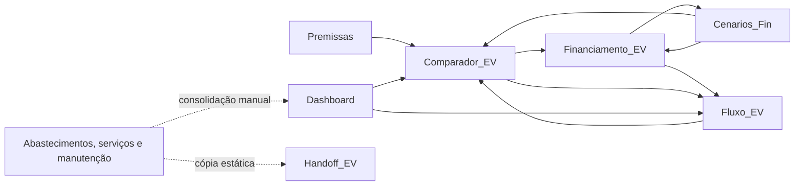

# Modelo financeiro

> Documento: FINANCIAL_MODEL
>
> Revisão do documento: 1.0.0
>
> Aplicação auditada: 1.1.0
>
> Commit base auditado: 63e48ad
>
> Data da auditoria: 2026-10-11
>
> Status: Vigente

## Governança e autoridade

Este documento é a autoridade normativa para fórmulas, conceitos financeiros, classificação de caixa, principal, juros e custos, precisão, estratégias de amortização, golden cases e decisões financeiras aprovadas.

A autoridade documental do projeto segue esta ordem por assunto:

1. `FINANCIAL_MODEL.md`: regras financeiras normativas.
2. `PRODUCT_SPEC.md`: funcionalidades, jornadas, UX funcional, escopo atual e roadmap.
3. `APPLICATION_GUIDE.md`: descrição as-built da aplicação, arquitetura, persistência e limitações reais.
4. Código e testes: evidência da implementação atual.

Uma divergência do código não revoga automaticamente uma regra normativa. Ela deve ser classificada como documentação desatualizada, gap de implementação ou decisão aberta.

As categorias usadas neste arquivo são:

- **Regra normativa atual:** obrigação financeira vigente.
- **Implementado na v1.x:** comportamento confirmado na aplicação auditada.
- **Roadmap:** regra ou capacidade aprovada conceitualmente, ainda não implementada.
- **Referência histórica da planilha:** comportamento observado no arquivo Excel, sem autoridade automática sobre a aplicação.

## 1. Objetivo e escopo

Este documento registra o comportamento financeiro observado na planilha de referência e define, separadamente, o modelo conceitual que deverá orientar o aplicativo.

Referência canônica: `reference/TCO_Tiida_EV_Financiamento_Integrado.xlsx`.

A referência descreve um Nissan Tiida e uma opção elétrica. Seus valores servem para reconciliação histórica e golden cases, não como regras, limites ou valores padrão do produto. A v1.x implementa ICE, HEV, PHEV e BEV.

### Classificação das regras

- **Formulada:** existe como fórmula rastreável na planilha.
- **Estática:** existe como valor digitado, importado ou copiado, sem vínculo ativo com sua origem.
- **Inferida:** foi deduzida de textos, resultados ou requisitos do produto, mas não está integralmente implementada por fórmula.

Toda referência de célula neste documento usa o formato `Aba!Intervalo`. Valores monetários estão em reais, salvo indicação contrária.

## 2. Glossário financeiro

### TCO de caixa

Soma das saídas operacionais atribuídas ao uso e à propriedade do veículo no período. Na referência, inclui energia ou combustível, manutenção, seguro, IPVA e licenciamento. Não inclui aquisição, entrada nem pagamento de principal do financiamento.

### TCO econômico

TCO de caixa acrescido dos custos econômicos reconhecidos no período. Conceitualmente, pode incluir depreciação e encargos financeiros quando houver regra normativa própria. **Na v1.x, o único componente econômico adicional ao TCO de caixa é a depreciação anual.**

### Fluxo de caixa do financiamento

Movimentação efetiva de caixa associada à dívida: entrada, prestações, juros, tarifas, seguros financeiros e amortizações extraordinárias. Deve ser apresentado separadamente do TCO operacional e do TCO econômico. Correção monetária pode integrar modelos futuros, mas não é implementada na v1.x.

### Principal amortizado

O pagamento de principal reduz caixa e passivo simultaneamente. Isoladamente, não é custo econômico e não reduz o patrimônio líquido. Juros, tarifas e outros encargos podem ser custos econômicos e reduzir o patrimônio líquido quando reconhecidos como despesa.

### Parcela líquida da troca

Na planilha atual:

```text
pagamento do financiamento
+ TCO de caixa mensal da opção de troca
- TCO de caixa mensal do Tiida
```

Resultado positivo representa saída adicional de caixa. Resultado negativo representa economia mensal de caixa.

## 3. Referência histórica da planilha

Esta seção é exclusivamente histórica. Ela descreve o comportamento observado na planilha de referência e não define automaticamente o comportamento normativo ou implementado da aplicação.

Esta seção descreve o que a referência faz hoje. Não transforma limitações, valores estáticos ou nomes centrados em EV em requisitos do aplicativo.

### 3.1 Abas e responsabilidades

| Aba | Responsabilidade atual |
| --- | --- |
| `Premissas` | Guarda premissas, fontes e alguns cálculos do Tiida. |
| `Abastecimentos_12m` | Contém 93 registros de abastecimento usados como histórico recente. |
| `Servicos_12m` | Contém 64 itens de serviço classificados para o TCO. |
| `Historico_Manutencao` | Consolida registros de manutenção desde 2021 e apresenta cenários estáticos. |
| `Historico_Mensal` | Consolida combustível, serviços, seguro e tributos por mês. |
| `Dashboard` | Apresenta o baseline do Tiida e sensibilidades de manutenção. |
| `Comparador_EV` | Reúne entradas da opção analisada, financiamento e resultados da troca. |
| `Financiamento_EV` | Calcula o cronograma mensal do cenário ativo por até 120 meses. |
| `Cenarios_Fin` | Compara três estratégias atuais de amortização. |
| `Fluxo_EV` | Projeta financiamento, operação e delta mensal de caixa. |
| `Handoff_EV` | Mantém um resumo textual estático para reutilização externa. |

Os nomes com sufixo `_EV` descrevem a implementação atual. Não definem o limite do domínio futuro.

### 3.2 Dependências entre abas



As setas de retorno representam células de resumo, não ciclos financeiros intencionais. Por exemplo, `Cenarios_Fin` usa entradas vinculadas de `Financiamento_EV`, enquanto este consulta o juros-base de `Cenarios_Fin` apenas para calcular a economia de juros.

As abas históricas não alimentam o `Dashboard` por fórmulas entre abas. Os valores foram consolidados e copiados, o que permite divergência após atualizações.

### 3.3 Entradas manuais observadas na planilha

#### Premissas do Tiida

As células manuais estão em `Premissas!B4:B6`, `B8`, `B10:B12` e `B14:B21`. `B7`, `B9` e `B13` são calculadas. As entradas abrangem odômetros, seguro, FIPE, alíquota de IPVA, licenciamento, preços e consumos de combustível, amortização das corretivas, depreciação e data-base.

#### Opção de troca e financiamento

| Grupo | Células atuais | Conteúdo |
| --- | --- | --- |
| Compra | `Comparador_EV!B5:B6`, `B8:B10`, `B12` | Identificação, preço, troca, entrada, custos financiados e valor financiado opcional. |
| Contrato | `Comparador_EV!F5:F11` | Taxa mensal, prazo, primeira parcela, correção, aporte padrão, início e reinvestimento. |
| Operação | `Comparador_EV!J5:J7`, `J9:J10`, `J12:J13` | Consumo, tarifa, perdas, seguro, IPVA, manutenção e depreciação. |
| Aportes manuais | `Financiamento_EV!I17:I136` | Valor extraordinário que substitui o aporte padrão naquele mês. |

`Comparador_EV!B7` e `J11` são vínculos com `Premissas`; `B11`, `B13`, `J8`, `J14:J17` são cálculos.

#### Histórico

- `Abastecimentos_12m!A4:I96`: lançamentos importados do Drivvo.
- `Servicos_12m!A4:H67`: serviços, categorias e valores.
- `Historico_Manutencao!A4:H27`: registros de manutenção, período e fonte.
- `Historico_Mensal!B5:F16`: consolidação mensal estática; somente a coluna `G` e os totais da linha 18 são fórmulas.

### 3.4 TCO do Tiida na planilha

O histórico de 12 meses usado no `Dashboard` soma combustível real, serviços, seguro, IPVA provisionado e licenciamento. O baseline prospectivo troca combustível e manutenção históricos por valores projetados, preservando seguro e tributos atuais.

```text
TCO de caixa central anual
= combustível projetado
+ manutenção central
+ seguro
+ IPVA
+ licenciamento
```

A depreciação anual do Tiida é adicionada somente no TCO econômico. O principal amortizado de eventual financiamento não participa dessas fórmulas.

#### Cenários atuais de manutenção

- **Otimista:** preventiva e desgaste dos últimos 12 meses mais um terço das corretivas.
- **Central:** custo histórico longo por quilômetro multiplicado pela rodagem anual.
- **Central+:** custo histórico longo acrescido da proxy de peças da OS 11032, convertido para a rodagem anual.
- **Stress:** valor anualizado da posse recente. A planilha não contém a fórmula completa que produz esse valor.

### 3.5 Operação da opção registrada na planilha

A opção registrada na planilha é tratada como BEV. O custo anual de energia em `Comparador_EV!J8` é:

```text
km anuais × kWh por 100 km ÷ 100 × tarifa por kWh × (1 + perdas)
```

O TCO de caixa anual da opção, em `J15`, soma energia, seguro, IPVA, licenciamento e manutenção. `J16` converte o total para mês. A depreciação anual em `J14` é `preço × taxa anual`; `J17` soma a depreciação ao TCO de caixa mensal.

### 3.6 Financiamento observado na planilha

O valor financiado em `Comparador_EV!B11` é limitado a zero:

```text
preço - valor líquido da troca - entrada adicional + custos financiados
```

`B13` usa esse cálculo quando disponível e recorre ao valor manual de `B12` quando o preço não foi preenchido.

A referência recebe uma taxa mensal em `Comparador_EV!F5`, transfere esse valor para `Financiamento_EV!C6` e o aplica diretamente como taxa do período. Ela não oferece entrada anual nem converte periodicidades.

As fórmulas do cronograma não realizam arredondamento intencional entre períodos. Os valores internos preservam a precisão do Excel, enquanto o formato das células exibe valores monetários com duas casas. A regra do aplicativo definida na seção 4.7 — empates para longe de zero (`halfExpand`, equivalente ao `half-up` convencional para valores não negativos) — é uma convenção nova do produto, não um comportamento comprovado da planilha.

Em `Financiamento_EV`, cada mês segue esta ordem:

1. Carrega o saldo final anterior.
2. Aplica correção monetária mensal ao saldo inicial.
3. Calcula juros sobre o saldo corrigido.
4. Recalcula a prestação para o saldo e prazo remanescentes.
5. Separa juros e principal da prestação.
6. Seleciona o aporte manual do mês ou o aporte recorrente padrão.
7. Calcula eventual reinvestimento da redução da prestação.
8. Limita aportes ao principal ainda disponível.
9. Calcula pagamento total e saldo final, sem permitir saldo negativo.

#### Estratégias existentes na referência

- **Baseline:** não aplica amortização extraordinária.
- **Normal:** aplica aporte padrão ou manual e recalcula a prestação para o prazo restante. Aproxima `reducePayment`.
- **Potencializada:** aplica o aporte e reinveste a redução da prestação para manter maior esforço de caixa. Aproxima `reduceTerm`, mas não representa um contrato específico de antecipação de parcelas finais.

A referência não implementa `prepayTailInstallments` como operação contratual a valor presente.

### 3.7 Resultados observados na planilha

`Fluxo_EV!A11:P130` projeta 120 meses. Em cada período:

- O pagamento financeiro vem de `Financiamento_EV`.
- Energia, manutenção, seguro e tributos são mensalizados a partir da opção de troca.
- O desembolso total da opção soma financiamento e operação.
- O baseline do Tiida usa o TCO de caixa mensal central.
- A parcela líquida é a diferença entre o desembolso da opção e o baseline do Tiida.

Os resumos mostram o primeiro mês, a média enquanto há financiamento, o fluxo após a quitação, o acumulado até a quitação, o prazo efetivo e a data estimada de quitação.

## 4. Modelo financeiro normativo atual da aplicação

Esta seção define as regras financeiras normativas vigentes. Ela não pressupõe abas, células ou nomes da planilha.

### 4.1 Estrutura comum de um veículo

Cada cenário deve declarar:

- Identificação e motorização: `ICE`, `HEV`, `PHEV` ou `BEV`.
- Valor de mercado e taxa anual de depreciação.
- Horizonte e quilometragem anual.
- Seguro, tributos, licenciamento e manutenção.
- Fontes de energia e respectivas eficiências, preços e perdas.
- Financiamento separado, quando aplicável.
- Moeda, periodicidade e regras de precisão e apresentação.

Na v1.x, o horizonte do TCO é anual normalizado. Os resultados são apresentados em valores anuais, mensais e por quilômetro: o valor mensal deriva do anual dividido por 12, e o valor por quilômetro deriva do anual dividido pela quilometragem anual. Análises por horizonte de posse permanecem no roadmap.

A depreciação da v1.x segue a regra anual simples:

```text
depreciação anual = valor do veículo × taxa anual de depreciação
```

Curvas de depreciação e valor residual por horizonte permanecem no roadmap. Essa escolha define o custo econômico anual da v1.x, mas não resolve a composição patrimonial da compra, da revenda ou do valor residual.

### 4.2 Energia por motorização

- **ICE:** consumo de combustível líquido em km/L ou L/100 km.
- **HEV:** mesma estrutura de combustível líquido, com eficiência própria do híbrido.
- **PHEV:** percentuais da quilometragem anual em modo elétrico e em combustão, totalizando 100%. Divisões por dias, viagens ou energia medida permanecem no roadmap.
- **BEV:** consumo em kWh/100 km, tarifa efetiva e perdas de recarga.

O modelo deve aceitar múltiplas fontes de energia sem duplicar a lógica de TCO. Cada fonte produz um custo anual; o TCO soma os custos das fontes ativas.

### 4.3 Separação dos resultados

O domínio deve produzir três visões independentes:

1. **TCO de caixa:** custos operacionais pagos no período.
2. **TCO econômico:** na v1.x, TCO de caixa mais depreciação anual.
3. **Fluxo do financiamento:** prestações, principal, juros, cobranças periódicas e aportes por período.

Aquisição, venda do veículo atual, entrada e principal permanecem separados do TCO. Na v1.x, juros, CET, tarifas financeiras, principal, correção monetária e outros encargos financeiros também não compõem o TCO econômico. Custos econômicos adicionais à depreciação dependem de decisão normativa futura.

### 4.4 Valor financiado e contrato PRICE

O valor financiado deve ser resolvido antes do cronograma. Se `price` estiver definido, inclusive quando for zero, o valor calculado tem precedência e o valor manual é ignorado:

```text
valorFinanciadoCalculado = max(
  0,
  preco
  - valorDeTroca
  - entradaAdicional
  + custosFinanciados
)
```

Valor de troca, entrada adicional e custos financiados ausentes equivalem a zero. Se `price` não estiver definido, `manualAmount` é obrigatório e se torna o principal. O contrato só pode gerar schedule quando o principal final for finito e maior que zero.

Para principal `P`, taxa mensal efetiva `i` e prazo remanescente `n`, a prestação PRICE de referência é:

```text
se i = 0:
  prestacao = P / n

se i != 0:
  prestacao = P × i / (1 - (1 + i)^(-n))
```

Em cada período, o cronograma usa o saldo inicial interno, calcula `juros = saldoInicial × i`, limita a amortização da parcela ao saldo elegível e aplica o aporte somente depois da prestação. A prestação efetivamente cobrada é `juros + amortização da parcela`; no último período ela pode ser menor que a prestação de referência para quitar o saldo sem torná-lo negativo. Cobranças periódicas entram em `totalPayment`, mas não alteram principal, juros ou saldo.

### 4.5 Estratégias de amortização

As estratégias são mutuamente distinguíveis:

- `none`: ignora a agenda de aportes extraordinários e mantém as cobranças periódicas.
- `reducePayment`: calcula a prestação do período antes do aporte, aplica o aporte ao saldo depois da prestação e recalcula prestações futuras. Normalmente preserva o prazo, mas pode quitar antes se o aporte eliminar todo o saldo elegível.
- `reduceTerm`: mantém a prestação de referência, aplica aportes ao saldo e reduz o prazo; a última prestação pode ser menor para quitar exatamente o saldo.

As únicas estratégias da v1.x são `none`, `reducePayment` e `reduceTerm`. `prepayTailInstallments` pertence exclusivamente ao roadmap e não participa da comparação atual.

No roadmap, `prepayTailInstallments` exige parcelas finais elegíveis, valor presente, data de liquidação, taxa de desconto, encargos preservados ou dispensados e arredondamento contratual. Uma eventual reserva separada não reduz a dívida nem gera custo econômico antes de ser utilizada. Somente uma liquidação integral elegível usa a reserva e amortiza principal. O tratamento de saldo remanescente na quitação permanece uma decisão aberta.

Essas regras conceituais de roadmap não representam comportamento da v1.x, da planilha nem do simulador de referência.

### 4.6 Agenda de aportes

A agenda deve ser independente da estratégia de amortização:

- **Único:** valor em um número de período.
- **Recorrente:** valor, primeiro período, último período opcional e frequência.
- **Manual:** substituição explícita do valor recorrente em um período.

O aporte efetivamente aplicado é limitado ao saldo elegível depois da prestação:

```text
aporteAplicado = min(aportePlanejado, saldoElegivelDepoisDaPrestacao)
```

O excedente não é aplicado, não vira custo, não é carregado para o período seguinte e não entra no total desembolsado. Tornar esse excedente mais visível é uma melhoria de UX possível, sem alterar esta regra financeira.

### 4.6.1 Consolidação operacional da v1.x

A v1.x mantém um veículo atual e múltiplas opções de troca. Comparação e Ciladômetro podem analisar até duas opções simultaneamente, mas cada cálculo permanece independente e sempre usa o veículo atual como referência. A área Financiamento continua associada a uma única opção por vez.

Os cards de veículos exibem como custo mensal o **TCO de caixa anual dividido por 12**. Valor de mercado e quilometragem são premissas separadas; copiar a quilometragem do veículo atual para uma opção apenas preenche o valor da entrada e não cria vínculo financeiro ou persistente.

O Ciladômetro usa o cronograma real de cada cenário. Para cada período ativo:

```text
impacto líquido do período = pagamento total do período - economia operacional mensal
```

O pagamento total do período já contém prestação contratual, aporte efetivamente aplicado e cobranças periódicas aplicáveis. Portanto, esses componentes não são somados novamente no Ciladômetro. Aportes únicos afetam somente sua ocorrência; aportes recorrentes e cobranças respeitam suas agendas. Para cada opção, a estratégia recomendada minimiza a soma desses impactos no prazo contratual original e empates são preservados. Na comparação entre duas opções, o horizonte comum é o maior prazo contratual original; depois da quitação, o pagamento financeiro é zero e o impacto mensal continua sendo o oposto da economia operacional mensal. A média divide o impacto acumulado por esse mesmo horizonte.

IPVA de 4% do valor do veículo para carro de passeio em São Paulo e licenciamento SP 2026 de R$ 174,08 são defaults editáveis de produto. Eles não substituem a obrigação de o usuário conferir exceções legais, fiscais ou valores de outros exercícios. Valores existentes e overrides manuais são preservados.

### 4.7 Taxas efetivas, precisão e arredondamento

`monthly` e `annual` representam taxas efetivas da respectiva periodicidade. Internamente, as taxas são expressas em forma decimal.

- Uma taxa `monthly` é usada diretamente como taxa do período.
- Uma taxa `annual` é convertida para a taxa mensal equivalente por:

```text
monthlyRate = (1 + annualRate)^(1/12) - 1
```

A taxa mensal convertida não sofre arredondamento intermediário. Taxas nominais anuais e CET não usam esta convenção e exigem tratamento próprio antes de integrarem o motor.

O motor não realiza arredondamento intencional em taxa, juros, principal, prestação ou saldo entre períodos. Cada período usa o saldo interno final do período anterior, preservando a precisão nativa do tipo numérico adotado. Totais são calculados a partir dos valores internos, não pela soma dos valores visualmente arredondados. Correção monetária não é implementada na v1.x; o modelo atual equivale a um contrato sem correção adicional.

A regra normativa de apresentação monetária é usar duas casas decimais e arredondar empates para longe de zero, modo `halfExpand` do `Intl.NumberFormat`, equivalente ao `half-up` convencional para valores não negativos. O padrão ECMA-402 define `halfExpand` como default quando `roundingMode` é omitido, e o runtime auditado apresenta esse comportamento. A implementação não declara o modo explicitamente e os testes não cobrem valores exatamente no meio do incremento; isso é uma **lacuna de teste e garantia explícita**, não um bug financeiro ou uma divergência de comportamento comprovada. A última amortização é limitada ao principal remanescente; o saldo final deve chegar exatamente a zero, sem se tornar negativo.

## 5. Catálogo de regras

As 46 regras abaixo separam a referência histórica da planilha (`C-*`) das regras gerais normativas ou de roadmap (`G-*`). As classificações “formulada”, “estática” e “inferida” descrevem a origem; a coluna Escopo define a autoridade atual.

| ID | Escopo | Classe | Origem | Regra, dependências e saída |
| --- | --- | --- | --- | --- |
| C-01 | Planilha histórica | Formulada | `Premissas!B4:B7` | Quilometragem anual = odômetro final − inicial. Saída em km/ano. |
| C-02 | Planilha histórica | Formulada | `Premissas!B8:B14` | Seguro anual = mensal × 12; IPVA = FIPE de janeiro × alíquota. Licenciamento é estático. |
| C-03 | Planilha histórica | Estática | `Abastecimentos_12m!A4:I96`; `Servicos_12m!A4:H67`; `Historico_Mensal!B5:F16` | Histórico e consolidações são valores importados ou copiados; não há vínculo entre as abas e o `Dashboard`. |
| C-04 | Planilha histórica | Inferida | `Dashboard!G7`; `Premissas!B7,B15,B17` | Combustível prospectivo = km anuais ÷ consumo de etanol × preço do etanol; arredondado a centavos no resultado exibido. |
| C-05 | Planilha histórica | Inferida | `Dashboard!B18:B21`; `Historico_Manutencao!K14:K24`; `Servicos_12m!D4:E67` | Quatro cenários de manutenção. Otimista, central e central+ são reconciliáveis; stress não possui fórmula integral. |
| C-06 | Planilha histórica | Formulada | `Dashboard!B7:D12` | TCO histórico anual = soma dos cinco componentes; mensal = anual ÷ 12; R$/km = anual ÷ km anuais. |
| C-07 | Planilha histórica | Formulada | `Dashboard!G7:H12` | TCO de caixa central anual = combustível + manutenção + seguro + IPVA + licenciamento; mensal = anual ÷ 12. |
| C-08 | Planilha histórica | Inferida | `Dashboard!G13:H13`; `Premissas!B11,B20` | Depreciação anual do Tiida = FIPE atual × taxa de depreciação; o resultado foi copiado para o `Dashboard`. |
| C-09 | Planilha histórica | Formulada | `Dashboard!G12:H14` | TCO econômico anual = TCO de caixa + depreciação; mensal = anual ÷ 12. |
| C-10 | Planilha histórica | Formulada | `Comparador_EV!B6:B11` | Valor financiado calculado = máximo entre zero e preço − troca − entrada + custos financiados. |
| C-11 | Planilha histórica | Formulada | `Comparador_EV!B11:B13` | Usa o valor calculado quando presente; caso contrário, usa o valor manual opcional. |
| C-12 | Planilha histórica | Formulada | `Comparador_EV!J5:J8` | Energia anual do BEV = km × kWh/100 km ÷ 100 × tarifa × (1 + perdas). |
| C-13 | Planilha histórica | Formulada | `Comparador_EV!J8:J16` | TCO de caixa anual da opção soma energia, seguro, IPVA, licenciamento e manutenção; mensal = anual ÷ 12. |
| C-14 | Planilha histórica | Formulada | `Comparador_EV!J13:J17` | Depreciação anual = preço × taxa; TCO econômico mensal = (TCO de caixa anual + depreciação) ÷ 12. |
| C-15 | Planilha histórica | Formulada | `Comparador_EV!C17`; `B33:D36` | Economia operacional = TCO de caixa mensal do Tiida − TCO de caixa mensal da opção. Comparações econômicas permanecem separadas. |
| C-16 | Planilha histórica | Formulada | `Financiamento_EV!C5:C7,F5` | Prestação inicial usa fórmula de anuidade com a taxa mensal aplicada diretamente; com taxa zero, divide principal pelo prazo. |
| C-17 | Planilha histórica | Formulada | `Financiamento_EV!C9,D17:F136` | Aplica correção ao saldo inicial e depois juros mensais sobre o saldo corrigido. |
| C-18 | Planilha histórica | Formulada | `Financiamento_EV!G17:H136` | Recalcula prestação para saldo e prazo restantes; principal programado = prestação − juros, limitado ao saldo. |
| C-19 | Planilha histórica | Formulada | `Financiamento_EV!C10:C11,I17:J136` | Aporte manual numérico substitui o recorrente no mês; vazio usa o aporte padrão após o mês inicial; negativo vira zero. |
| C-20 | Planilha histórica | Formulada | `Financiamento_EV!C12,K17:M136` | Se ativado, reinvestimento = diferença positiva entre prestação inicial e recalculada, respeitando o saldo disponível. |
| C-21 | Planilha histórica | Formulada | `Financiamento_EV!L17:O136` | Aportes e a última amortização são limitados ao principal remanescente; pagamento total soma prestação e aportes; saldo final não pode ser negativo. |
| C-22 | Planilha histórica | Formulada | `Financiamento_EV!F6:F7` | Prazo efetivo e quitação usam o primeiro mês em que o saldo final chega a zero. |
| C-23 | Planilha histórica | Formulada | `Financiamento_EV!F8:F12,H7:H12` | Resume juros, aportes, reinvestimento, total pago, economia de juros e redução de prestação. |
| C-24 | Planilha histórica | Formulada | `Cenarios_Fin!A4:AG154` | Calcula baseline, normal e potencializada em cronogramas paralelos; horizonte máximo de 120 meses. |
| C-25 | Planilha histórica | Formulada | `Fluxo_EV!F11:N130` | Parcela líquida mensal = pagamento financeiro + operação da opção − TCO de caixa do Tiida. |
| C-26 | Planilha histórica | Formulada | `Fluxo_EV!D4` | Média até a quitação = soma da parcela líquida nos meses com pagamento financeiro ÷ quantidade desses meses. |
| C-27 | Planilha histórica | Formulada | `Fluxo_EV!F4` | Após a quitação = TCO de caixa mensal da opção − TCO de caixa mensal do Tiida. |
| C-28 | Planilha histórica | Formulada | `Fluxo_EV!H4,P11:P130` | Acumulado até a quitação soma a parcela líquida enquanto há pagamento; a coluna P mantém o acumulado mensal completo. |
| G-01 | Normativo v1.x | Inferida | Regra aprovada | O TCO usa horizonte anual normalizado e apresenta resultados anuais, mensais e por quilômetro; horizonte de posse permanece no roadmap. |
| G-02 | Normativo v1.x | Inferida | Regra aprovada | TCO econômico = TCO de caixa + depreciação anual. Nenhum componente financeiro adicional integra o TCO econômico atual. |
| G-03 | Normativo v1.x | Inferida | Regra aprovada | Fluxo do financiamento detalha principal, juros, cobranças e aportes sem misturá-los ao TCO; correção monetária não é implementada. |
| G-04 | Normativo v1.x | Inferida | Regra aprovada | ICE e HEV calculam custo por fonte líquida a partir de distância, eficiência e preço. |
| G-05 | Normativo v1.x | Inferida | Regra aprovada | BEV calcula eletricidade a partir de distância, consumo, tarifa e perdas. |
| G-06 | Normativo v1.x | Inferida | Regra aprovada | PHEV divide a quilometragem anual por percentuais entre modo elétrico e combustão, totalizando 100% e sem dupla contagem. |
| G-07 | Normativo v1.x | Inferida | Regra aprovada | Principal reduz caixa e passivo no mesmo valor; isoladamente, não altera patrimônio líquido nem custo econômico. |
| G-08 | Normativo v1.x | Inferida | Regra aprovada | `none` ignora aportes extraordinários e mantém cobranças periódicas. |
| G-09 | Normativo v1.x | Inferida | Regra aprovada | `reducePayment` calcula a prestação antes do aporte, aplica o aporte ao saldo e recalcula prestações futuras; normalmente preserva o prazo, mas pode quitar antes. |
| G-10 | Normativo v1.x | Inferida | Regra aprovada | `reduceTerm` mantém a prestação de referência, reduz o prazo e pode ajustar a última prestação ao saldo. |
| G-11 | Roadmap | Inferida | Conceito aprovado | `prepayTailInstallments` liquida parcelas finais elegíveis somente segundo regras contratuais suficientes e não integra as estratégias da v1.x. |
| G-12 | Normativo v1.x | Inferida | Regra aprovada | Aportes únicos, um plano recorrente e substituições manuais formam uma agenda independente da estratégia de amortização. |
| G-13 | Normativo v1.x | Inferida | Regra aprovada | `monthly` e `annual` são taxas efetivas. A mensal é usada diretamente; a anual é convertida por `monthlyRate = (1 + annualRate)^(1/12) - 1`, sem arredondamento intermediário. |
| G-14 | Normativo v1.x com lacuna de teste | Inferida | Regra aprovada | O cronograma preserva a precisão interna, calcula totais com valores internos e limita a última amortização. A apresentação monetária usa duas casas e empates para longe de zero (`halfExpand`; equivalente ao `half-up` convencional para valores não negativos). O default normativo de `Intl.NumberFormat` e o runtime auditado coincidem; falta teste específico de empate e configuração explícita. |
| G-15 | Normativo v1.x | Inferida | Regra aprovada | Depreciação anual = valor do veículo × taxa anual de depreciação; curvas e valor residual por horizonte permanecem no roadmap. |
| G-16 | Roadmap | Inferida | Conceito aprovado | A futura reserva de `prepayTailInstallments` não reduz a dívida ou gera custo econômico antes do uso; somente uma liquidação integral elegível usa a reserva. |
| G-17 | Normativo v1.x | Inferida | Regra aprovada | Valor financiado calculado = `max(0, preço − troca − entrada adicional + custos financiados)`; quando o preço está disponível, esse cálculo tem precedência. O valor manual é apenas fallback sem preço calculável. |
| G-18 | Normativo v1.x | Inferida | Regra aprovada | O contrato usa PRICE: com taxa positiva, `prestação = principal × taxa × (1 + taxa)^prazo ÷ ((1 + taxa)^prazo − 1)`; com taxa zero, `prestação = principal ÷ prazo`. Cada período calcula juros sobre o saldo inicial, e amortização da parcela = prestação − juros, limitada ao saldo. |

Contagem: 24 regras formuladas, 1 estática e 21 inferidas; 46 regras no total.

## 6. Golden cases de reconciliação

Os casos abaixo reproduzem a referência histórica. A tolerância monetária é R$ 0,01. O motor preserva valores internos sem arredondamento intencional entre períodos. Os valores esperados são apresentados com duas casas e empates para longe de zero (`halfExpand`; equivalente ao `half-up` convencional para valores não negativos). O default normativo de `Intl.NumberFormat` e o runtime auditado coincidem, mas os testes da v1.1.0 não cobrem valores exatamente no meio do incremento. Taxas e meses respeitam as convenções de cada caso.

| Caso | Entradas ou cálculo independente | Esperado | Status |
| --- | --- | --- | --- |
| Quilometragem anual | 226.298 − 204.860 | 21.438 km | Reconciliado |
| Combustível real | Soma de `Abastecimentos_12m!E4:E96` | R$ 13.267,21 | Reconciliado |
| TCO histórico anual | 13.267,21 + 17.782,46 + 3.516,24 + 1.404,88 + 174,08 | R$ 36.144,87 | Reconciliado |
| TCO histórico mensal | 36.144,87 ÷ 12 | R$ 3.012,07 | Reconciliado |
| Combustível projetado | 21.438 ÷ 7,68 × 3,89 | R$ 10.858,57/ano | Reconciliado |
| Manutenção otimista | 4.498,46 + 12.723,00 ÷ 3 | R$ 8.739,46/ano | Reconciliado |
| Manutenção central | 48.321,20 ÷ 88.533 × 21.438 | R$ 11.700,83/ano | Reconciliado |
| Manutenção central+ | (48.321,20 + 4.874,60) ÷ 88.533 × 21.438 | R$ 12.881,20/ano | Reconciliado |
| Manutenção stress | Valor estático do cenário | R$ 15.295,73/ano | Não reconciliado integralmente |
| TCO de caixa central anual | Soma dos cinco componentes prospectivos | R$ 27.654,60 | Reconciliado |
| TCO de caixa central mensal | 27.654,60 ÷ 12 | R$ 2.304,55 | Reconciliado |
| Depreciação anual do Tiida | 37.044,00 × 3% | R$ 1.111,32 | Reconciliado |
| TCO econômico central anual | 27.654,60 + 1.111,32 | R$ 28.765,92 | Reconciliado |
| TCO econômico central mensal | 28.765,92 ÷ 12 | R$ 2.397,16 | Reconciliado |
| Valor financiado | 120.000,00 − 40.000,00 | R$ 80.000,00 | Reconciliado |
| Prestação inicial | R$ 80.000,00; 1,7% a.m.; 48 meses | R$ 2.451,51 | Reconciliado |
| Juros totais | Soma do cronograma sem aportes | R$ 37.672,53 | Reconciliado |
| Total pago | Principal + juros | R$ 117.672,53 | Reconciliado |
| Energia anual da opção | 21.438 × 12 ÷ 100 × 2,00 × 1,10 | R$ 5.659,63 | Reconciliado |
| TCO de caixa anual da opção | Energia + seguro + IPVA + licença + manutenção | R$ 16.603,71 | Reconciliado |
| TCO de caixa mensal da opção | 16.603,71 ÷ 12 | R$ 1.383,64 | Reconciliado |
| Depreciação anual da opção | 120.000,00 × 3,5% | R$ 4.200,00 | Reconciliado |
| TCO econômico mensal da opção | (16.603,71 + 4.200,00) ÷ 12 | R$ 1.733,64 | Reconciliado |
| Economia operacional | 2.304,55 − 1.383,64 | R$ 920,91/mês | Reconciliado |
| Parcela líquida no mês 1 | 2.451,51 + 1.383,64 − 2.304,55 | R$ 1.530,60 | Reconciliado |
| Fluxo após quitação | 1.383,64 − 2.304,55 | −R$ 920,91/mês | Reconciliado |

Resultado: 25 golden cases reconciliados e 1 não reconciliado integralmente.

### Caso de teste de equivalência de taxa efetiva

Este caso valida a nova entrada anual do aplicativo e não altera a contagem dos golden cases extraídos da planilha:

```text
1,7% a.m. efetivos
⇔ (1 + 0,017)^12 - 1
≈ 22,4197350053% a.a. efetivos
```

As duas entradas devem produzir, dentro da precisão nativa do motor, a mesma taxa mensal de `0,017` sem arredondamento intermediário e preservar os golden cases PRICE correspondentes: prestação inicial de R$ 2.451,51, juros totais de R$ 37.672,53 e total pago de R$ 117.672,53.

## 7. Limitações da referência

Estas limitações descrevem a planilha e não são comportamentos desejados para o aplicativo.

1. Os dois gráficos do `Dashboard` apontam para séries `#REF!`.
2. `Dashboard`, `Handoff_EV` e vários resumos históricos armazenam snapshots sem vínculo ativo com as tabelas de origem.
3. `Dashboard!F14:I14` está mesclado sobre os cálculos armazenados em `G14:H14`. As fórmulas existem no arquivo, mas ficam ocultas pela mesclagem e podem ser frágeis em recálculos ou edições.
4. O cenário stress de manutenção vale R$ 15.295,73/ano, mas sua fórmula não está presente. O valor implica uma anualização aproximada diferente do intervalo observável completo da posse recente.
5. `Historico_Mensal` exibe outubro de 2025 a setembro de 2026, enquanto o `Dashboard` declara uma janela móvel exata. A reconciliação depende das tabelas brutas, não apenas do total mensal exibido.
6. O financiamento usa uma taxa mensal aplicada diretamente e correção, mas não possui entrada anual nem entrada explícita de CET, tarifas, IOF ou seguros financeiros.
7. A correção monetária aumenta o saldo e afeta pagamentos futuros, mas não integra explicitamente o total de juros usado na leitura econômica.
8. O cronograma é limitado a 120 meses. Um prazo maior pode gerar resumos incoerentes ou incompletos.
9. A estratégia potencializada aproxima redução de prazo por reinvestimento, sem representar regras contratuais de uma financeira.
10. `prepayTailInstallments` não existe na referência.
11. A lógica operacional da opção cobre apenas eletricidade; ICE, HEV e PHEV não possuem cálculos próprios.
12. Apenas a opção de reinvestimento possui validação de lista. As entradas numéricas não têm limites ou mensagens de validação proporcionais ao risco.
13. A depreciação é linearmente aproximada por `preço × taxa anual`, sem horizonte de posse, curva de valor residual ou preço de revenda.
14. O TCO atual não explicita inflação, valor do dinheiro no tempo ou data de cada custo operacional.
15. Entrada, troca e principal aparecem no fluxo financeiro, mas não há uma visão completa de patrimônio ou valor residual ao final do horizonte.

## 8. Decisões, gaps e roadmap financeiro

### 8.1 Questões históricas ainda inferidas

- Fórmula original do cenário stress.
- Processo usado para copiar históricos para o `Dashboard` e para o `Handoff_EV`.
- Se a correção monetária deve compor custo econômico, ajuste do principal ou ambos para fins gerenciais.
- Se a estratégia potencializada representa uma regra real da financeira ou apenas uma simulação matemática.
- Fonte e periodicidade futura para FIPE, tributos, tarifas e preços de energia.

### 8.2 Regras normativas vigentes, originadas no baseline da v1

1. **Periodicidade da taxa:** `monthly` e `annual` são efetivas. A taxa mensal é usada diretamente e a anual é convertida pela equivalência composta definida na seção 4.7, sem arredondamento intermediário.
2. **Precisão e arredondamento:** o cronograma preserva a precisão nativa entre períodos, calcula totais com valores internos e a regra de apresentação exige duas casas com empates para longe de zero (`halfExpand`). A última amortização encerra o principal sem saldo negativo.
3. **Horizonte do TCO:** visão anual normalizada, apresentada por ano, por mês e por quilômetro. Horizonte de posse permanece no roadmap.
4. **PHEV:** divisão percentual da quilometragem anual entre modo elétrico e combustão, totalizando 100%. Outros critérios de divisão permanecem no roadmap.
5. **Depreciação:** regra anual simples `valor do veículo × taxa anual de depreciação`. Curvas e valor residual por horizonte permanecem no roadmap.
6. **TCO econômico da v1.x:** TCO de caixa mais depreciação anual, sem componentes financeiros adicionais.
7. **Contrato sem correção:** correção monetária não é implementada; o motor atual equivale a um contrato sem correção adicional.

### 8.3 Lacuna de teste e garantia explícita

- **Arredondamento visual:** a v1.1.0 usa `Intl.NumberFormat` sem `roundingMode` explícito. O default normativo ECMA-402 é `halfExpand`, e o runtime auditado confirma empates para longe de zero. Não há divergência de comportamento observada; falta um teste de regressão específico para empates e, se desejado, a declaração explícita do modo. Cálculo interno, totais e saldo não apresentam gap conhecido de precisão intencional.

### 8.4 Roadmap financeiro

- SAC.
- `prepayTailInstallments`, com valor presente, parcelas finais elegíveis e regras contratuais próprias.
- Reserva separada para `prepayTailInstallments`, sem redução da dívida antes do uso.
- Múltiplos planos recorrentes e múltiplos contratos/cenários salvos.
- Horizonte de posse, valor residual e curvas de depreciação.
- Inflação, valor do dinheiro no tempo, CET, taxas nominais e correção monetária, somente após decisões normativas explícitas.

### 8.5 Decisões financeiras ainda abertas

1. **Aquisição, revenda e patrimônio:** como mostrar entrada, troca, principal, revenda e valor residual sem misturar caixa com custo econômico. A depreciação simples da v1.x não resolve essa composição patrimonial.
2. **CET e taxas nominais anuais:** quais encargos serão informados diretamente, quais serão derivados do contrato e como convenções diferentes de taxa efetiva serão representadas.
3. **Correção monetária:** classificação econômica, índice, periodicidade e interação com juros.
4. **`prepayTailInstallments`:** fórmula de valor presente, parcelas e datas elegíveis, descontos, tarifas, arredondamento contratual e tratamento de eventual reserva remanescente na quitação.

## 9. Critérios de regressão e testes futuros

- Implementar cálculos financeiros como funções puras, fora dos componentes React.
- Cobrir cada regra formulada com pelo menos um caso nominal e casos de zero, vazio e limite matemático.
- Usar os golden cases reconciliados como testes de regressão, sem promovê-los a valores padrão.
- Preservar testes separados para `none`, `reducePayment` e `reduceTerm`. Testar `prepayTailInstallments` somente quando entrar no roadmap implementável.
- Verificar que amortização de principal altera caixa e passivo, mas não o custo econômico isoladamente.
- Confirmar que aportes únicos, recorrentes e manuais afetam somente os períodos previstos.
- Testar ICE, HEV, PHEV e BEV com as mesmas interfaces de TCO e fontes de energia distintas.
- Confirmar que o TCO anual normalizado reconcilia suas apresentações mensal e por quilômetro e que análises por horizonte de posse não são calculadas na v1.x.
- Verificar que os percentuais elétrico e a combustão do PHEV totalizam 100% da quilometragem anual, sem dupla contagem.
- Reconciliar a depreciação anual simples como `valor do veículo × taxa anual de depreciação`, sem inferir curva ou valor residual.
- Para a futura `prepayTailInstallments`, testar que a reserva não reduz a dívida antes do uso e só liquida parcela integralmente coberta. O tratamento do saldo remanescente será testado apenas depois da decisão normativa ainda aberta.
- Reconciliar somas anuais e mensais com tolerância de R$ 0,01, preservando a precisão nativa entre períodos.
- Confirmar que `1,7% a.m.` e aproximadamente `22,4197350053% a.a.` efetivos geram a mesma taxa mensal interna e preservam os golden cases PRICE correspondentes.
- Testar que a taxa anual convertida, os juros, o principal, a prestação e o saldo não sofrem arredondamento intencional intermediário. Correção monetária só entra nesse critério quando implementada.
- Calcular totais a partir dos valores internos e testar separadamente a exibição monetária com duas casas em `halfExpand`, incluindo empates positivos e negativos.
- Verificar que cada período usa o saldo interno final anterior e que a última amortização encerra o saldo em zero sem torná-lo negativo.
- Rejeitar taxas, prazos, consumos, preços ou percentuais inválidos em vez de produzir zeros plausíveis.
- Exibir TCO de caixa, TCO econômico e fluxo do financiamento como resultados separados em toda a interface.

## Histórico de revisões

| Revisão | Aplicação auditada | Data | Alterações |
| --- | --- | --- | --- |
| 1.0.0 | 1.1.0 (`63e48ad`) | 2026-10-11 | Início da governança formal; separação entre norma, implementação, roadmap e planilha; consolidação normativa do valor financiado e PRICE; correções de TCO econômico, estratégias, excedentes, correção monetária e classificação do arredondamento. |
